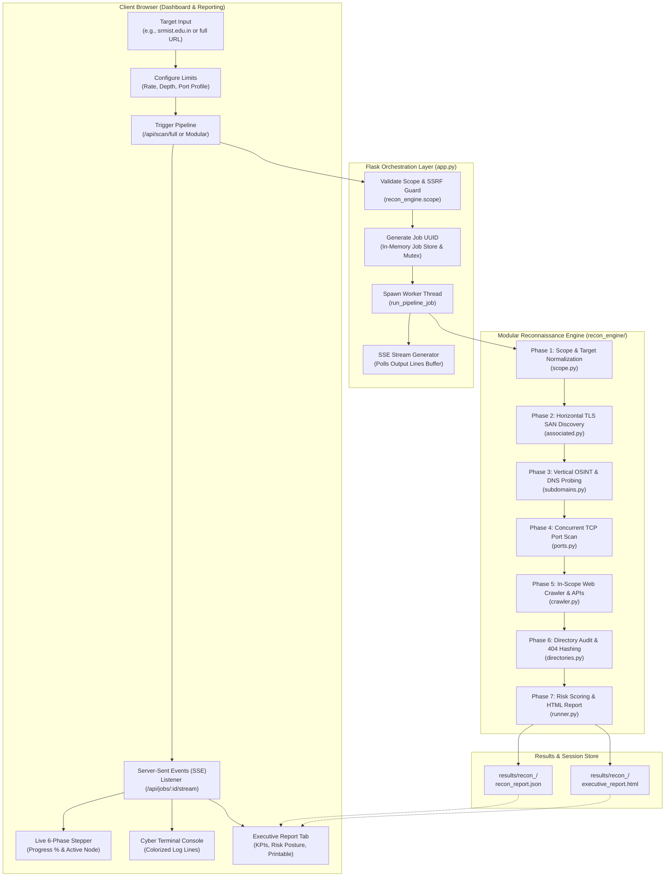

# 🛡️ VAPT Universal Reconnaissance Suite v2.0
## 📘 Comprehensive Architecture, Engineering & Developer Handover Guide

> **Document Version:** 2.0.0  
> **Target Audience:** Incoming Software Engineers, Security Developers, and DevOps Specialists  
> **Project Repository:** `Scanner Tool / vapt-webapp`  
> **Primary Technology Stack:** Python 3.11–3.13, Flask, Async Sockets, BeautifulSoup4, Cryptography, Vanilla JavaScript (ES6+), Server-Sent Events (SSE), Responsive Cyber-Terminal CSS.

---

## 📑 Table of Contents
1. [Executive Overview & Project Mission](#1-executive-overview--project-mission)
2. [End-to-End System Architecture](#2-end-to-end-system-architecture)
   - [High-Level Flow Diagram](#high-level-flow-diagram)
   - [Architectural Design Patterns](#architectural-design-patterns)
3. [Repository Directory & File-by-File Breakdown](#3-repository-directory--file-by-file-breakdown)
   - [Root Directory](#root-directory)
   - [`recon_engine/` (Core Modular Engine)](#recon_engine-core-modular-engine)
   - [`scripts/` (Legacy Shell Compatibility)](#scripts-legacy-shell-compatibility)
   - [`templates/` & `static/` (Frontend Layer)](#templates--static-frontend-layer)
4. [Key Objects, Data Schemas & Contracts](#4-key-objects-data-schemas--contracts)
   - [Job Store Data Model](#job-store-data-model)
   - [Pipeline Result Schema (`ReconResult`)](#pipeline-result-schema-reconresult)
   - [Risk Assessment Model](#risk-assessment-model)
   - [SSE Streaming & Console Logging Protocol](#sse-streaming--console-logging-protocol)
5. [Deep Dive: End-to-End Reconnaissance Pipeline](#5-deep-dive-end-to-end-reconnaissance-pipeline)
   - [Phase 1: Scope Validation & Safety Policy Guard](#phase-1-scope-validation--safety-policy-guard)
   - [Phase 2: Horizontal OSINT (Associated Roots via TLS SANs)](#phase-2-horizontal-osint-associated-roots-via-tls-sans)
   - [Phase 3: Vertical OSINT (Subdomain Enumeration & DNS Probing)](#phase-3-vertical-osint-subdomain-enumeration--dns-probing)
   - [Phase 4: Network Layer (TCP Port Scan & Service Banners)](#phase-4-network-layer-tcp-port-scan--service-banners)
   - [Phase 5: Application Layer (DOM Crawler & Inline API Spider)](#phase-5-application-layer-dom-crawler--inline-api-spider)
   - [Phase 6: Content Layer (Directory & Sensitive Secret Audit)](#phase-6-content-layer-directory--sensitive-secret-audit)
   - [Phase 7: Synthesis & Executive Report Compilation](#phase-7-synthesis--executive-report-compilation)
6. [Tools, Technologies & Third-Party Dependencies](#6-tools-technologies--third-party-dependencies)
7. [Installation, Setup & Execution Instructions](#7-installation-setup--execution-instructions)
   - [Windows Environment](#windows-environment)
   - [Linux / macOS Environment](#linux--macos-environment)
   - [Verification Steps](#verification-steps)
8. [Complete REST API & SSE Endpoints Reference](#8-complete-rest-api--sse-endpoints-reference)
9. [UI Features, Educational Guide & Live Progress Stepper](#9-ui-features-educational-guide--live-progress-stepper)
10. [Current Progress vs. Pending Tasks & Roadmap](#10-current-progress-vs-pending-tasks--roadmap)
11. [Developer FAQ, Gotchas & Troubleshooting](#11-developer-faq-gotchas--troubleshooting)

---

## 1. Executive Overview & Project Mission

The **VAPT Universal Reconnaissance Suite** is a modular, authorized attack surface mapping and exposure assessment platform. Originally architected as a shell-script utility restricted to Indian government domains (`.gov.in`), the system has undergone a complete architectural evolution into a **cross-platform, multi-TLD enterprise intelligence platform**.

### Core Objectives
1. **Universal Multi-TLD Scope**: Seamlessly assess any fully qualified domain name (FQDN) or full web URL across any Top-Level Domain (e.g., `srmist.edu.in`, `du.edu.in`, `iitd.ac.in`, `mit.edu`, `delhi.gov.in`, `target.com`).
2. **Authorized & Safe Testing Boundaries**: Built-in safeguards preventing server-side request forgery (SSRF), blocking RFC 1918 loopback and cloud metadata ranges (`169.254.169.254`), and enforcing token-bucket rate limiting (5–30 req/s).
3. **Multi-Layer Attack Surface Coverage**:
   - **Horizontal Reconnaissance**: Sibling root domain discovery via TLS/SSL Subject Alternative Names (SANs) and CA organization logs.
   - **Vertical Reconnaissance**: Passive Certificate Transparency (CT) log aggregation, DNS liveness probing, HTTP probing, and WAF fingerprinting.
   - **Network Surface**: Multi-port asynchronous TCP socket scanning and service banner acquisition.
   - **Application Surface**: In-scope DOM spidering, navigation mapping, and regex-powered hidden API route discovery (`/api/...`).
   - **Content & Secret Layer**: High-risk configuration auditing (`.env`, `.git/HEAD`, `wp-config.php`) with dynamic custom-404 baseline hashing to eradicate false positives.
4. **Real-Time Visibility & Executive Reporting**:
   - Live visual status stepper displaying the active phase and progress percentage (0–100%).
   - Interactive educational methodology guide embedded inside the UI.
   - One-click executive VAPT report generator providing printable HTML/PDF summaries, Markdown, JSON, and plain text exports.

---

## 2. End-to-End System Architecture

### High-Level Flow Diagram



### Architectural Design Patterns
* **Decoupled Asynchronous Engine**: The reconnaissance logic (`recon_engine/`) is decoupled from Flask, implemented in pure cross-platform Python. It can be invoked programmatically via CLI or imported into microservices.
* **Non-Blocking SSE Streaming**: Jobs execute in background worker threads with thread-safe output buffers (`jobs_lock`), allowing client web pages to consume streaming console lines without polling HTTP overhead.
* **Structural Signature & Baseline Validation**: Eliminates false positives in directory auditing by measuring target response content lengths, MD5 hashes of random non-existent URLs, and content regex matching.
* **Separation of Presentation & Business Logic**: The dashboard utilizes semantic HTML5, reactive Vanilla JavaScript, and CSS custom properties without requiring heavy frameworks (React, Vue, or Webpack builds).

---

## 3. Repository Directory & File-by-File Breakdown

```
vapt-webapp/
│
├── app.py                                   # Flask application, REST API, SSE streaming & job scheduler
├── start.bat                                # Windows launcher with Python 3.13 auto-detection
├── start.sh                                 # Linux/macOS bash launch script
├── requirements.txt                         # Python runtime dependencies
├── README.md                                # Project summary & quickstart documentation
├── PROJECT_ARCHITECTURE_AND_DEVELOPER_HANDOVER.md  # Complete engineering handover guide (this file)
│
├── recon_engine/                            # Modular, pure-Python security assessment engine
│   ├── __init__.py                          # Package initialization
│   ├── scope.py                             # Scope validation, domain normalization, SSRF/IP guards
│   ├── associated.py                        # Horizontal OSINT: TLS SAN extraction & CT org queries
│   ├── subdomains.py                        # Vertical OSINT: crt.sh, CertSpotter, Anubis, DNS probing
│   ├── ports.py                             # Network layer: Concurrent TCP socket scanner & banners
│   ├── crawler.py                           # App layer: In-scope DOM spider, forms, scripts & regex APIs
│   ├── directories.py                       # Content layer: Sensitive secret checks & 404 baseline hash
│   └── runner.py                            # Pipeline orchestrator, risk scorer & HTML report compiler
│
├── scripts/                                 # Legacy Linux shell scripts (retained for backward compatibility)
│   ├── subdomain_finder.sh                  # Subfinder/Amass/Assetfinder bash wrapper
│   ├── dir_search.sh                        # FFUF sensitive file verification script
│   ├── common_dir_scan.sh                   # Common directory path tester
│   └── common.txt                           # Default directory dictionary wordlist (38 KB)
│
├── templates/
│   ├── index.html                           # Main web dashboard, stepper, guide & report viewer
│   └── india.svg                            # Vector graphic used in Indian national security themes
│
└── static/
    ├── css/
    │   └── style.css                        # Glassmorphism cyber-recon UI, stepper & @media print styles
    ├── js/
    │   └── app.js                           # Frontend controller, SSE client, stepper & table renderer
    └── images/
        ├── emblem.png                       # National emblem emblem logo
        └── i4c_logo.webp                    # Indian Cyber Crime Coordination Centre logo
```

### File-by-File Technical Deep Dive

#### 1. `app.py` (Flask REST Server & Job Controller)
* **Lines of Code:** ~900 lines
* **Responsibilities:**
  - Manages the in-memory `jobs` dictionary with `threading.Lock()` mutex synchronization.
  - Implements endpoints: `/api/scan/full`, `/api/scan/subdomains`, `/api/scan/associated`, `/api/scan/ports`, `/api/scan/crawler`, `/api/scan/directories`.
  - Implements SSE streaming endpoint `/api/jobs/<job_id>/stream` yielding `data: {"line": "...", "status": "..."}\n\n`.
  - Implements `/api/jobs/<job_id>/report/html` serving the executive HTML report in-browser.
  - Implements `/api/jobs/<job_id>/export?format=html|md|json|txt` generating downloadable reports.
  - Implements `/download/handover-guide` serving this developer guide as a direct attachment.
  - Implements authorized Git-Dumper endpoint `/api/gitdump/start` requiring explicit confirmation.

#### 2. `recon_engine/scope.py` (Target & Scope Governance)
* **Responsibilities:**
  - `normalize_domain(raw_input)`: Strips schemes (`http://`, `https://`), port numbers (`:8080`), and URI paths (`/portal`), returning a clean lowercase FQDN.
  - `validate_target(domain)`: Regex checks against `DOMAIN_REGEX` to ensure legal FQDN structure. Prevents command injection characters (`;`, `&`, `|`, `$`, `` ` ``).
  - **SSRF & Loopback Defense**: Checks resolved IP against `127.0.0.0/8`, `::1`, and link-local cloud metadata (`169.254.0.0/16`).
  - **Split-Horizon DNS Support**: Allows organization FQDNs that resolve to internal campus/corporate IP ranges (e.g. `srmist.edu.in` resolving to `172.16.111.117` on university Wi-Fi) while strictly forbidding users from entering raw private IP addresses directly.
  - `RateLimiter`: Token bucket algorithm enforcing maximum requests-per-second constraints.

#### 3. `recon_engine/associated.py` (Horizontal Reconnaissance)
* **Responsibilities:**
  - Connects to port 443 of the target host using Python `ssl` and retrieves the peer X.509 certificate.
  - Extracts the Subject Alternative Names (SANs) extension (`subjectAltName`).
  - Identifies distinct sibling apex domains owned by the same entity.
  - Interrogates `crt.sh/?O=<OrgName>` to discover root domains sharing certificate authority registrations.

#### 4. `recon_engine/subdomains.py` (Vertical OSINT & Host Discovery)
* **Responsibilities:**
  - Queries public Certificate Transparency logs: `crt.sh`, `CertSpotter API`, `AnubisDB`, and `HackerTarget`.
  - Deduplicates wildcard certificates (e.g. `*.domain.com`).
  - Concurrently resolves `A` and `AAAA` DNS records using system resolvers or `dnspython`.
  - Actively probes responsive hosts over HTTP and HTTPS, extracting HTTP response codes, `Server` headers, page titles, and WAF signatures (Cloudflare, Cloudfront, Akamai, Imperva).

#### 5. `recon_engine/ports.py` (Network Port Scanner)
* **Responsibilities:**
  - Fast asynchronous socket connect scanner (`socket.socket(socket.AF_INET, socket.SOCK_STREAM)`).
  - Profiles:
    - `web`: Ports `80`, `443`, `3000`, `5000`, `8000`, `8080`, `8081`, `8443`, `8888`.
    - `infra`: Web ports plus SSH `22`, FTP `21`, SMTP `25`, MySQL `3306`, PostgreSQL `5432`, Redis `6379`, Kubernetes `6443`.
  - Banner grabber: Reads the initial service banner string (SSH versions, FTP greetings, HTTP response lines).

#### 6. `recon_engine/crawler.py` (Web Application Spider)
* **Responsibilities:**
  - In-scope DOM crawler built on `requests` and `BeautifulSoup4`.
  - Spiders anchor tags (`<a href>`), forms (`<form action>`), and external script assets (`<script src>`).
  - Strict scope containment: Discards or tags third-party domains as `External` to prevent crawling out of bounds.
  - **Inline API Route Discovery**: Utilizes regular expressions to extract API endpoints embedded in JavaScript bundles (`/api/v[0-9]/[a-zA-Z0-9_\-/]+`, `/auth/...`, `/graphql`).

#### 7. `recon_engine/directories.py` (Content & Secret Exposure Auditor)
* **Responsibilities:**
  - Audits high-risk files: `/.env`, `/.git/HEAD`, `/.svn/entries`, `/composer.json`, `/package.json`, `/config.php`, `/wp-config.php`, `/robots.txt`.
  - **Dynamic Custom-404 Baseline Fingerprinting**: Sends a request to a random 16-character nonexistent URI (e.g. `/rnd_404_a9f1b8c2d3e4`) and computes the MD5 hash and byte length of the response. Wildcard 200 responses matching the baseline length or hash are eliminated.
  - **Structural Content Verification**:
    - `/.env`: Must contain assignment syntax (`KEY=VALUE` or `DB_PASSWORD=`).
    - `/.git/HEAD`: Must match `ref: refs/heads/`.
    - `/robots.txt`: Must contain `User-agent:` or `Disallow:`.

#### 8. `recon_engine/runner.py` (Orchestrator & Risk Scoring Engine)
* **Responsibilities:**
  - Coordinates all six modules in sequence within `execute_recon_pipeline()`.
  - Emits real-time progress events over the logger callback (`[PHASE:1:START]`, `[PHASE:2:START]`, `[PHASE:DONE]`).
  - Computes the **Attack Surface Risk Score (0–100)**:
    - Base score: 10
    - Active verified leaks (`.env`, `.git`): +35 per exposure
    - Unencrypted protocols (FTP 21, Telnet 23): +15
    - Exposed database ports (MySQL 3306, Redis 6379): +20
    - Missing HSTS / security headers: +10
    - Categorizes posture into **LOW**, **MEDIUM**, **HIGH**, or **CRITICAL**.
  - Generates standalone, publication-ready executive HTML reports (`executive_report.html`) complete with `@media print` CSS for browser-to-PDF export.

---

## 4. Key Objects, Data Schemas & Contracts

### Job Store Data Model
In `app.py`, all scans are tracked in memory using a dictionary indexed by UUID:

```python
jobs[job_id] = {
    "id": "e8d7a31b-24c5-4b89-a1b2-c3d4e5f6a7b8",
    "type": "full",               # "full" | "subdomain" | "associated" | "ports" | "crawler" | "directories"
    "domain": "srmist.edu.in",
    "status": "running",           # "pending" | "running" | "completed" | "failed" | "stopped"
    "output_lines": [              # Thread-safe log buffer consumed by SSE
        "[*] Target domain / URL: srmist.edu.in",
        "[PHASE:1:START] Target Scope Validation & SSRF Guard",
        "[✓] Scope verified: srmist.edu.in is authorized.",
        "[PHASE:2:START] Associated Roots Discovery via TLS SANs",
        # ...
    ],
    "result": {},                  # Populated upon pipeline completion (see ReconResult schema)
    "created_at": "2026-10-14T12:00:00.000000",
    "finished_at": "2026-10-14T12:02:15.000000",
    "pid": None                    # Operating system process ID if external process is spawned
}
```

### Pipeline Result Schema (`ReconResult`)
The dictionary returned by `execute_recon_pipeline()` and stored in `recon_report.json`:

```json
{
  "domain": "srmist.edu.in",
  "raw_url": "https://www.srmist.edu.in",
  "scan_type": "full",
  "timestamp": "2026-10-14T12:00:00.000000",
  "total_subdomains": 42,
  "alive_count": 28,
  "risk_assessment": {
    "score": 35,
    "level": "MEDIUM",
    "color": "#ffd166",
    "recommendations": [
      {
        "severity": "MEDIUM",
        "title": "Strict Transport Security (HSTS) Missing",
        "desc": "Host did not return a Strict-Transport-Security header.",
        "action": "Enforce 'Strict-Transport-Security: max-age=31536000; includeSubDomains' on all HTTPS listeners."
      }
    ]
  },
  "associated_domains": [
    {
      "domain": "srmuniv.ac.in",
      "relationship": "TLS Certificate SAN",
      "source": "TLS X.509 Peer Certificate"
    }
  ],
  "subdomains": {
    "total": 42,
    "alive": 28,
    "records": [
      {
        "subdomain": "portal.srmist.edu.in",
        "ip": "13.202.226.128",
        "alive": true,
        "status_code": 200,
        "server": "nginx/1.22.1",
        "waf": "Direct",
        "title": "SRM Student Portal Login",
        "url": "https://portal.srmist.edu.in"
      }
    ]
  },
  "ports": {
    "open_count": 3,
    "findings": [
      {
        "host": "srmist.edu.in",
        "port": 443,
        "protocol": "tcp",
        "service": "HTTPS",
        "banner": "HTTP/1.1 200 OK Server: nginx"
      }
    ]
  },
  "crawler": {
    "total_crawled": 15,
    "pages": [
      {
        "url": "https://www.srmist.edu.in/admissions",
        "status": 200,
        "depth": 1,
        "type": "Internal"
      }
    ],
    "api_endpoints": [
      "/api/v1/auth/student-login",
      "/api/v2/events/announcements"
    ],
    "scripts": [
      "https://www.srmist.edu.in/assets/js/main.bundle.js"
    ],
    "external_references": [
      "https://fonts.googleapis.com"
    ]
  },
  "directories": {
    "sensitive_findings": [],
    "directory_findings": [
      {
        "url": "https://www.srmist.edu.in/images/",
        "status": 200,
        "size": 1420
      }
    ]
  },
  "recon_dir": "C:\\...\\results\\recon_srmist.edu.in",
  "report_file": "C:\\...\\results\\recon_srmist.edu.in\\recon_report.json",
  "html_report_file": "C:\\...\\results\\recon_srmist.edu.in\\executive_report.html"
}
```

### SSE Streaming & Console Logging Protocol
Log lines emitted during execution adhere to a standardized token format consumed by the frontend parser:

| Token / Prefix | Semantic Meaning | Frontend Action |
| :--- | :--- | :--- |
| `[PHASE:X:START]` | Triggering pipeline phase `X` (1–6) | Advances stepper node `X` to `.active`, updates progress % |
| `[PHASE:DONE]` | All pipeline phases finished | Sets progress bar to 100%, turns all step nodes `.completed` |
| `[+] Discovered X` | OSINT discovery count update | Updates Subdomain Counter in top KPI cards |
| `[✓] ALIVE:` | Subdomain HTTP probe succeeded | Increments "Alive Hosts" KPI metric |
| `[PORT]` | Open TCP port confirmed | Increments "Open Ports" KPI metric |
| `[Depth X]` | Web crawler page spidered | Increments "Crawled Routes" KPI metric |
| `[EXPOSED]` | Verified sensitive file leak | Increments "Secret Exposures" metric, triggers red alert |
| `[!]` or `[ERROR]` | Warning or non-fatal exception | Colorizes line yellow/red in the cyber terminal |

---

## 5. Deep Dive: End-to-End Reconnaissance Pipeline

### Phase 1: Scope Validation & Safety Policy Guard
1. Extracts base hostname via `normalize_domain()`.
2. Validates FQDN syntax and disallows bash/shell metacharacters.
3. Tests DNS resolution to prevent scanning loopback (`127.0.0.1`, `localhost`) or AWS instance metadata (`169.254.169.254`).
4. Accommodates split-horizon corporate/campus DNS resolution for legitimate registered institutional domains.

### Phase 2: Horizontal OSINT (Associated Roots via TLS SANs)
1. Establishes a TLS handshake with the root domain over port 443.
2. Extracts Subject Alternative Names (SANs) from the X.509 certificate.
3. Performs crt.sh organizational queries to discover sister infrastructure registered under identical corporate identity.

### Phase 3: Vertical OSINT (Subdomain Enumeration & DNS Probing)
1. Concurrently queries Certificate Transparency indices (crt.sh, CertSpotter, Anubis, HackerTarget).
2. Deduplicates records, trims wildcard prefixes (`*.`), and discards out-of-scope hostnames.
3. Resolves DNS records using concurrent threads.
4. Sends lightweight HTTP/HTTPS GET requests to alive hosts to catalog status codes, web server signatures, WAF identities, and `<title>` tags.

### Phase 4: Network Layer (TCP Port Scan & Service Banners)
1. Concurrently probes target hosts against top web and infrastructure ports using non-blocking TCP sockets.
2. Sends probes with configurable timeouts (default 1.0s) to maintain ethical scanning standards.
3. Collects raw service banners upon initial socket connect.

### Phase 5: Application Layer (DOM Crawler & Inline API Spider)
1. Begins crawling at target root URL up to depth limit (default 2).
2. Collects all internal links, `<form>` actions, and `<script src>` links.
3. Evaluates HTML markup and linked scripts using regex to discover undocumented API routes (`/api/v1/...`).

### Phase 6: Content Layer (Directory & Sensitive Secret Audit)
1. Requests random non-existent URL to baseline the server's custom 404 response length and MD5 hash.
2. Audits critical files (`.env`, `.git/HEAD`, `wp-config.php`, `robots.txt`).
3. Evaluates status code (HTTP 200) and executes structural content verification (e.g. `ref: refs/heads` in `.git/HEAD`).
4. Eliminates wildcard false positives using baseline comparison.

### Phase 7: Synthesis & Executive Report Compilation
1. Collates findings from all preceding stages into a unified dictionary.
2. Computes the **Attack Surface Risk Score (0–100)** and categorizes severity (**LOW**, **MEDIUM**, **HIGH**, **CRITICAL**).
3. Generates actionable strategic remediation recommendations.
4. Compiles publication-ready standalone HTML report (`executive_report.html`) and structured JSON (`recon_report.json`).

---

## 6. Tools, Technologies & Third-Party Dependencies

### Backend Technologies
* **Python 3.11 / 3.12 / 3.13**: Core runtime environment.
* **Flask (`flask`)**: Lightweight WSGI microframework providing REST API endpoints and job routing.
* **Flask-CORS (`flask-cors`)**: Enables Cross-Origin Resource Sharing for API consumers.
* **Requests (`requests`)**: Synchronous HTTP library for OSINT lookups, HTTP probing, and crawling.
* **BeautifulSoup4 (`bs4`)**: HTML/XML DOM parser utilized for link and route extraction.
* **Sockets & SSL (`socket`, `ssl`)**: Built-in Python networking libraries for raw TCP port scanning and X.509 certificate retrieval.
* **HTTPX (`httpx`)**: Optional asynchronous HTTP client.
* **Threading (`threading`, `threading.Lock`)**: Concurrent job execution and thread-safe data synchronization.

### Frontend Technologies
* **HTML5 Semantic Markup**: Accessible and responsive layout.
* **CSS3 Custom Properties (Variables)**: Dark cyber-terminal glassmorphic theme.
* **Vanilla JavaScript (ES6+)**: Zero external JavaScript frameworks (no React, Vue, or Webpack dependencies).
* **Server-Sent Events (`EventSource`)**: Real-time unidirectionally streamed terminal logs and progress events.
* **CSS Print Stylesheet (`@media print`)**: Formats executive reports for direct browser printing and Save-to-PDF export.

---

## 7. Installation, Setup & Execution Instructions

### Prerequisites
* **Python**: Python 3.11, 3.12, or 3.13 installed and added to system `PATH`.
* **Git**: (Optional) For version control operations.

### Windows Environment

```cmd
# 1. Navigate to the project directory
cd "C:\Users\diyar\Downloads\Scanner_Tool\Scanner Tool\vapt-webapp"

# 2. Install dependencies
python -m pip install -r requirements.txt

# 3. Launch the application
start.bat
```

> **Note**: `start.bat` automatically checks for Python 3.13 at `%LOCALAPPDATA%\Programs\Python\Python313\python.exe` and falls back to system `python`.

### Linux / macOS Environment

```bash
# 1. Navigate to the project directory
cd vapt-webapp

# 2. Ensure shell scripts are executable
chmod +x start.sh scripts/*.sh

# 3. Create virtual environment & install dependencies
python3 -m venv venv
source venv/bin/activate
pip install -r requirements.txt

# 4. Launch the application
./start.sh
```

### Verification Steps
1. Open your browser and navigate to **`http://127.0.0.1:5000`**.
2. Verify that the status dot in the upper-right corner displays green (**Ready**).
3. Click any target preset (e.g. `srmist.edu.in`) and click **Full Recon Pipeline ▶**.
4. Confirm that the **Pipeline Stepper** advances from Stage 1 to Stage 6 and the terminal logs stream in real time.

---

## 8. Complete REST API & SSE Endpoints Reference

| Method | Endpoint | Description | Request Payload / Params | Response Format |
| :--- | :--- | :--- | :--- | :--- |
| `GET` | `/` | Serves main single-page application dashboard | None | `text/html` |
| `POST` | `/api/scan/full` | Initiates complete 6-phase reconnaissance pipeline | `{"domain": "target.edu.in", "options": {...}}` | `{"job_id": "...", "domain": "..."}` |
| `POST` | `/api/scan/subdomains` | Runs vertical subdomain enumeration & DNS probing | `{"domain": "target.edu.in"}` | `{"job_id": "...", "domain": "..."}` |
| `POST` | `/api/scan/associated` | Runs horizontal TLS SAN root domain discovery | `{"domain": "target.edu.in"}` | `{"job_id": "...", "domain": "..."}` |
| `POST` | `/api/scan/ports` | Runs asynchronous TCP port & banner scan | `{"domain": "target.edu.in", "options": {...}}` | `{"job_id": "...", "domain": "..."}` |
| `POST` | `/api/scan/crawler` | Spiders in-scope DOM and uncovers inline API routes | `{"domain": "target.edu.in", "options": {...}}` | `{"job_id": "...", "domain": "..."}` |
| `POST` | `/api/scan/directories`| Audits common paths, sensitive files & 404 hashing | `{"domain": "target.edu.in", "options": {...}}` | `{"job_id": "...", "domain": "..."}` |
| `GET` | `/api/jobs/<job_id>/stream` | Server-Sent Events (SSE) stream of real-time logs | None | `text/event-stream` |
| `GET` | `/api/jobs/<job_id>/status` | Retrieves current status and result dictionary | None | `application/json` |
| `POST` | `/api/jobs/<job_id>/stop` | Terminates active scan subprocess safely | None | `{"ok": true, "job_id": "..."}` |
| `GET` | `/api/jobs/<job_id>/report/html` | Displays standalone executive HTML report in browser | None | `text/html` |
| `GET` | `/api/jobs/<job_id>/export` | Downloads report in specified format | `?format=html\|md\|json\|txt` | Attachment download |
| `GET` | `/api/sessions` | Lists all historical scan sessions | None | `application/json` |
| `GET` | `/download/handover-guide` | Downloads this developer handover guide | None | `text/markdown` attachment |
| `POST` | `/api/gitdump/start` | Authorized extraction of exposed `.git` repositories | `{"git_head_url": "...", "authorized": true}` | `{"label": "...", "status": "started"}` |

---

## 9. UI Features, Educational Guide & Live Progress Stepper

### 1. Universal Target Input & Preset Chips
- Input box accepts raw domains (`srmist.edu.in`) or full URLs (`https://www.srmist.edu.in/portal`).
- One-click preset chips for prominent targets: `srmist.edu.in`, `iitd.ac.in`, `du.edu.in`, `mit.edu`, `delhi.gov.in`.

### 2. Live 6-Phase Pipeline Stepper
- Located immediately below the configuration controls.
- Displays animated progress percentage (`0%` to `100% Completed`).
- Phase indicator nodes:
  - `1. Scope Guard` (Target normalization & SSRF checks)
  - `2. Associated Roots` (Horizontal TLS SANs)
  - `3. Subdomains & DNS` (Vertical OSINT & HTTP probing)
  - `4. Open Ports` (TCP connect scan & banners)
  - `5. Web Crawler` (DOM spider & API discovery)
  - `6. Dir & Secrets` (Structural signatures & 404 hashing)
- Nodes pulse in cyan while active and transition to solid green upon successful completion.

### 3. In-UI Methodology & Architecture Guide
- Collapsible interactive drawer located at the top of the interface.
- Explains for each phase:
  - **What it does**: Technical explanation of the methodology.
  - **Tools powering it**: Underlying libraries and services.
  - **Auditor Value**: Why security assessors need this data and what risk it addresses.

### 4. Executive Report Dashboard (`#module-report`)
- Dedicated top-level tab in the main navigation.
- **Attack Surface Risk Banner**: Displays overall score (0–100) and severity rating (**LOW**, **MEDIUM**, **HIGH**, **CRITICAL**).
- **Executive KPI Cards**: Subdomains Discovered, Active Web Hosts, Open Ports, Crawled Routes, Verified Secret Exposures, Associated Roots.
- **Strategic Remediation Priorities**: Color-coded action items with specific technical remediation steps.
- **Printable / PDF-Ready Report**: Click **"🖨️ View & Print Full Report"** to open a clean report ready for Save-to-PDF export.

---

## 10. Current Progress vs. Pending Tasks & Roadmap

### Completed Milestones (Current State)
- [x] Multi-TLD engine expansion supporting `.edu.in`, `.ac.in`, `.gov.in`, `.edu`, `.com`, `.org`, and any full URL.
- [x] SSRF and RFC 1918 private IP protection with split-horizon DNS compatibility.
- [x] Pure-Python modular reconnaissance engine (`recon_engine/`) running cross-platform on Windows, Linux, and macOS.
- [x] Real-time Server-Sent Events (SSE) streaming with thread-safe output buffers.
- [x] In-UI educational methodology guide and multi-phase progress stepper.
- [x] Executive VAPT report generator (in-app view, printable HTML/PDF, Markdown, JSON, and plain text).
- [x] Authorized Git-Dumper integration requiring legal confirmation checkbox.

### Recommended Pending Tasks & Next-Generation Roadmap

```mermaid
flowchart LR
    subgraph NearTerm ["Phase 1: Near-Term Enhancements"]
        N1["SQLite / PostgreSQL<br/>Persistent Database"]
        N2["Async DNS Resolver<br/>(aiodns / aiodnsprep)"]
        N3["Automated PDF Engine<br/>(WeasyPrint / Playwright)"]
    end

    subgraph MidTerm ["Phase 2: Advanced Capabilities"]
        M1["Nuclei Template Scanner<br/>Integration"]
        M2["Celery / Redis Distributed<br/>Task Queue"]
        M3["Scheduled Automated<br/>Recon Crons"]
    end

    subgraph LongTerm ["Phase 3: Enterprise Integration"]
        L1["Role-Based Access<br/>Control (RBAC)"]
        L2["SIEM & Webhook Alerts<br/>(Slack, Jira, Teams)"]
        L3["Attack Surface Diffing<br/>(Weekly Drift Analysis)"]
    end

    NearTerm --> MidTerm --> LongTerm
```



#### Detailed Roadmap Item Descriptions:
1. **Persistent Database Store (SQLite / PostgreSQL)**:
   - *Current*: Jobs and session histories are stored in memory (`jobs = {}`), which resets if the server restarts.
   - *Task*: Transition the job store to an SQLite or PostgreSQL database via SQLAlchemy so scan sessions, reports, and logs persist permanently.
2. **Asynchronous DNS Resolver (`aiodns`)**:
   - *Current*: `subdomains.py` uses `socket.gethostbyname` within thread pools.
   - *Task*: Implement `aiodns` or `dnspython.asyncresolver` to resolve thousands of subdomains in seconds.
3. **Automated Headless PDF Generation**:
   - *Current*: PDF export relies on browser printing (`window.print()`).
   - *Task*: Integrate `playwright` or `weasyprint` on the backend so `/api/jobs/<job_id>/export?format=pdf` returns a generated PDF file directly.
4. **Nuclei Vulnerability Template Engine Integration**:
   - *Current*: Content scanning checks common sensitive files (`.env`, `.git`).
   - *Task*: Add an optional module to execute community-maintained YAML vulnerability templates (CVE checks, misconfigurations) against discovered alive hosts.
5. **Attack Surface Drift & Differential Analysis**:
   - *Task*: Allow users to compare two scan jobs for the same domain and highlight new subdomains, newly opened ports, or resolved vulnerabilities over time.

---

## 11. Developer FAQ, Gotchas & Troubleshooting

### Q1: Why did `srmist.edu.in` initially fail validation on campus Wi-Fi?
* **Cause**: On university Wi-Fi or corporate networks, local DNS resolvers map the institution's public domain to an internal RFC 1918 gateway IP (e.g., `172.16.111.117`). Early SSRF filters strictly rejected all RFC 1918 addresses.
* **Resolution**: In `recon_engine/scope.py`, the validation logic strictly blocks loopbacks (`127.0.0.1`, `localhost`) and AWS metadata (`169.254.169.254`). For RFC 1918 private subnets, it permits multi-part public domain names (split-horizon DNS) while blocking users from entering raw private IP addresses directly.

### Q2: Why avoid Unicode characters like `✓` in terminal logs?
* **Cause**: On Windows systems running default code pages (e.g., `cp1252`), non-ASCII Unicode characters (`\u2713` ✓) raise `UnicodeEncodeError: 'charmap' codec can't encode character`.
* **Resolution**: Standardize all console log prefixes across `recon_engine/` and `app.py` to safe ASCII tokens (`[+]`, `[✓]` as `[OK]` or `[+]`, `[PORT]`, `[EXPOSED]`, `[!]`).

### Q3: How do I add a new reconnaissance stage to the pipeline?
1. Create your module in `recon_engine/my_stage.py` with an entrypoint function (e.g. `run_my_stage(domain, options, log_cb)`).
2. In `recon_engine/runner.py`, import your module and call `log_cb("[PHASE:X:START] My New Stage")`.
3. Append your findings to the `result` dictionary and update `calculate_risk_assessment()`.
4. In `templates/index.html`, add a step node to `#pipeline-stepper-card` and add a results panel/tab.
5. In `static/js/app.js`, update `updateStepper()` and create a render function for your stage's findings.

### Q4: How is rate limiting enforced across threads?
* `recon_engine/scope.py` provides a `RateLimiter` class using a token-bucket interval mechanism. Each crawler and directory worker calls `limiter.wait()` prior to issuing HTTP requests, ensuring polite and legally compliant request rates.

---

*This guide was generated for the VAPT Universal Reconnaissance Suite. For updates or feature proposals, open an issue or pull request in the project repository.*
