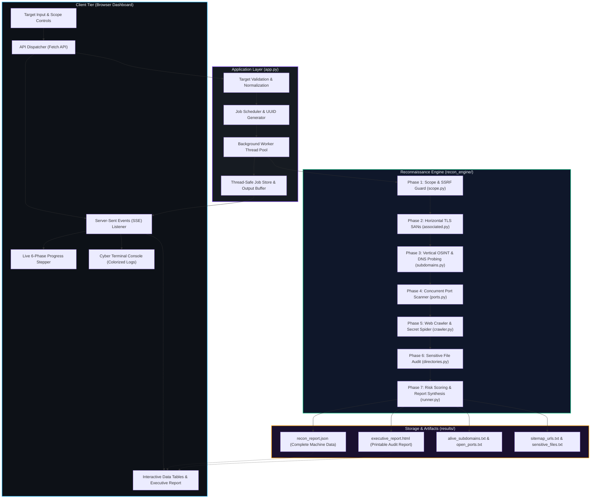

# 🛡️ VAPT Universal Reconnaissance Suite (v2.1)

> **Enterprise-Grade Multi-TLD Attack Surface Intelligence & Vulnerability Assessment Platform**  
> *Engineered for authorized penetration testers, red teams, bug bounty hunters, and security operations centers (SOC).*

---

## 📋 Table of Contents

- [Overview](#-overview)
- [Key Features](#-key-features)
- [System Architecture](#-system-architecture)
- [End-to-End Pipeline & Step-by-Step Flow](#-end-to-end-pipeline--step-by-step-flow)
- [Repository Structure & Component Breakdown](#-repository-structure--component-breakdown)
- [Technology Stack & Dependencies](#-technology-stack--dependencies)
- [Installation & Setup](#-installation--setup)
- [Configuration & Environment Variables](#-configuration--environment-variables)
- [Execution & Usage](#-execution--usage)
- [REST API & SSE Protocol Reference](#-rest-api--sse-protocol-reference)
- [Scan Artifacts & Reporting](#-scan-artifacts--reporting)
- [Verification & Diagnostics](#-verification--diagnostics)
- [Security, Scope & Legal Disclaimer](#-security-scope--legal-disclaimer)

---

## 🌟 Overview

The **VAPT Universal Reconnaissance Suite** is a modular, high-performance security assessment and intelligence gathering platform. It automates horizontal and vertical attack surface discovery, network perimeter profiling, web application crawling, secret exposure auditing, and executive risk synthesis.

Originally designed as a shell-script utility restricted to Indian government domains (`.gov.in`), v2.1 has been completely re-engineered into a **pure Python, cross-platform engine** capable of assessing any fully qualified domain name (FQDN) or URL across all international Top-Level Domains (`.edu`, `.ac.in`, `.gov`, `.org`, `.com`, `.io`, etc.).

### Why This Platform?
- **Zero External Binary Dependencies Required**: Operates out of the box using a pure Python concurrency engine (thread pools, async sockets, raw HTTP parser) without requiring `subfinder`, `nmap`, or `ffuf`.
- **False-Positive Elimination**: Features dynamic Custom-404 baseline MD5 hashing and structural signature validation (e.g. verifying `.env` contains key-value pairs and `.git/HEAD` points to refs) to eradicate soft-404 false alarms.
- **Enterprise Scope Guard**: Enforces strict SSRF protection, dropping RFC 1918 private subnets, loopbacks, and cloud metadata services (`169.254.169.254`).
- **Real-Time Streaming Visibility**: Streams live execution logs to a modern cyber-terminal dashboard using Server-Sent Events (SSE) alongside a 6-phase visual progress stepper.
- **Automated Risk Scoring**: Calculates an automated exposure posture score (10–100) and compiles printable executive HTML/PDF audit reports with actionable remediation advisories.

---

## ✨ Key Features

| Capability | Description |
| :--- | :--- |
| **Universal Multi-TLD Scope** | Accepts bare domains, FQDNs, URLs with ports, or subdomains across any global TLD. |
| **SSRF & Private Network Guard** | Prevents internal scanning; blocks `127.0.0.0/8`, `169.254.0.0/16`, `10.0.0.0/8`, `172.16.0.0/12`, and `192.168.0.0/16`. |
| **Horizontal Reconnaissance** | Uncovers sibling organizations and root domains via TLS Subject Alternative Names (SANs) and Certificate Authority logs. |
| **Passive OSINT Aggregation** | Collects subdomains from crt.sh, CertSpotter, Anubis, AlienVault OTX, and HackerTarget without sending direct packets to the target. |
| **Concurrent DNS & HTTP Probing** | Resolves `A`, `AAAA`, and `CNAME` records, validates wildcard DNS, probes HTTP/HTTPS services, extracts HTML titles, and fingerprints Web Application Firewalls (WAFs). |
| **Subdomain Takeover Detection** | Matches CNAME fingerprints against 13+ vulnerable external cloud providers (GitHub Pages, AWS S3, Heroku, Azure, Fastly, Shopify, etc.). |
| **Network Port Matrix** | Scans top web (80, 443, 8080, etc.) and critical infrastructure ports (21, 22, 3306, 5432, 6379, 27017) with service banner grabbing and unauthenticated Redis/Memcached detection. |
| **DOM Crawler & Hidden APIs** | Recursively spiders in-scope HTML pages to catalog internal links, form actions, script sources, and regex-detected REST/GraphQL API endpoints (`/api/...`, `/v1/...`). |
| **High-Entropy Secret Hunter** | Scans crawled resources for leaked AWS keys, Google API keys, Stripe tokens, GitHub PATs, Slack webhooks, SendGrid credentials, private keys, and JWTs. |
| **Sensitive File Audit** | Audits for exposed `.env`, `.git/HEAD`, `.svn`, `wp-config.php`, database dumps, and server backups with response verification. |
| **Authorized Git-Dumper** | Safely extracts exposed `.git` repositories with legal authorization confirmation via CLI or pure Python fallback. |
| **Executive Reporting** | Generates executive HTML reports, machine-readable JSON, Markdown summaries, and plain text exports. |

---

## 🏗️ System Architecture

The suite is structured into a decoupled, three-tier architecture: the **Presentation Layer** (Glassmorphism web dashboard), the **Orchestration Layer** (Flask application server with SSE streaming), and the **Execution Engine** (`recon_engine/` modular Python package).



> **Visual Diagram Viewer**: For high-resolution SVG viewing, open `vapt_diagram_viewer.html` or inspect `vapt_architecture_flow.svg`.

---

## 🔄 End-to-End Pipeline & Step-by-Step Flow

When a scan is initiated (either via the Web Dashboard or the CLI runner), the target domain transitions through seven strictly coordinated phases:

```
[Target Ingestion]
       │
       ▼
[Phase 1: Scope Validation]  ──► (Normalize FQDN, Reject RFC 1918 / AWS Metadata, Init Token Bucket)
       │
       ▼
[Phase 2: Horizontal OSINT]  ──► (Extract TLS SANs from Apex & WWW, Query crt.sh Org Trees)
       │
       ▼
[Phase 3: Vertical OSINT]    ──► (Passive CT Logs + DNS Resolution + Takeover Check + HTTP Probe)
       │
       ▼
[Phase 4: Network Port Scan] ──► (TCP Connect Matrix + TLS Banner Grabbing + Redis/Service Checks)
       │
       ▼
[Phase 5: Web DOM Crawler]   ──► (Recursive Spider + Hidden /api/ Routes + High-Entropy Secret Scan)
       │
       ▼
[Phase 6: Content Audit]     ──► (Custom-404 Hashing + Sensitive File Probing + Content Validation)
       │
       ▼
[Phase 7: Report Synthesis]  ──► (Calculate 10-100 Risk Score + Render Executive HTML & JSON)
```

### Phase 1: Target Normalization & Scope Guard (`scope.py`)
- Normalizes raw input (`https://sub.target.com:8443/portal` $\rightarrow$ `sub.target.com`).
- Enforces syntax integrity using RFC-compliant hostname regex.
- Resolves domain to IP and screens against `BLOCKED_NETWORKS` (`127.0.0.0/8`, `169.254.0.0/16`, multicast `224.0.0.0/4`).
- Instantiates a thread-safe token-bucket `RateLimiter` (5–30 req/s) to ensure target stability.

### Phase 2: Horizontal OSINT & Associated Roots (`associated.py`)
- Establishes non-validating TLS handshakes with apex and `www` hosts to harvest Subject Alternative Names (SANs).
- Queries Certificate Transparency logs for common organization subject records.
- Identifies sister domains, affiliate infrastructures, and alternate root TLDs owned by the target entity.

### Phase 3: Vertical OSINT, DNS & Liveness Probing (`subdomains.py`)
- Aggregates subdomains from 5 distinct passive sources: **crt.sh**, **CertSpotter**, **Anubis**, **AlienVault OTX**, and **HackerTarget**.
- Tests for DNS wildcard catch-alls using high-entropy random hostnames (`wildcard-check-<timestamp>.<target>`).
- Performs concurrent DNS queries (`A`, `AAAA`, `CNAME`) using `dnspython` with thread pools.
- Detects **Subdomain Takeover** risks by cross-referencing CNAME pointers against known fingerprints (GitHub Pages, AWS S3, Heroku, Azure, Fastly, Shopify, etc.).
- Probes live web targets over HTTP/HTTPS, recording response codes, server headers, page titles, and WAF presence (Cloudflare, AWS WAF, Akamai, Imperva).
- Analyzes DNS security posture: checks for `SPF` and `DMARC` TXT records.

### Phase 4: Network Surface & Port Matrix (`ports.py`)
- Executes asynchronous TCP connect scans across target hosts using selectable profiles:
  - **Web Ports**: `80, 443, 3000, 5000, 8000, 8080, 8081, 8443, 8888, 9000`
  - **Infrastructure Ports**: 25 common services (FTP, SSH, Telnet, SMTP, DNS, SMB, MySQL, RDP, Postgres, Redis, etc.)
  - **Extended Profile**: 65+ specialized ports (Elasticsearch, MongoDB, Docker, Kubernetes, RabbitMQ, cPanel)
- Grabs service banners via TLS-wrapped sockets on HTTPS ports and raw TCP sockets on plain services.
- Detects critical misconfigurations like unauthenticated Redis instances responding with `+PONG` to `PING` commands.

### Phase 5: Application Surface DOM Spider & API Route Mining (`crawler.py`)
- Recursively traverses in-scope HTML links up to configurable depth (default: 2 levels).
- Parses DOM trees using `BeautifulSoup4` to catalog internal navigation URLs, `<form action>` targets, and external dependencies.
- Extracts inline API routes and REST endpoints using regex matching (`/(api|v[0-9]+|rest|auth|graphql|oauth)/...`).
- Scans crawled page contents and JavaScript files for leaked credentials and high-entropy secrets (AWS Keys, Google API Keys, Stripe Tokens, GitHub PATs, Slack Webhooks, Private Keys, JWTs).

### Phase 6: Content Layer & Sensitive Secret Audit (`directories.py`)
- Establishes a **Dynamic Custom-404 Baseline**: Probes randomized pseudo-paths (`/<random_hex>`) to calculate baseline content lengths, MD5 hashes, and soft-404 title signatures.
- Tests target web servers for sensitive file exposures:
  - Configuration: `/.env`, `/.env.local`, `/.env.production`, `/.env.bak`
  - Source Repositories: `/.git/HEAD`, `/.git/config`, `/.svn/entries`
  - Dependencies: `/composer.json`, `/package.json`
  - CMS / Frameworks: `/wp-config.php`, `/config.php`, `/phpinfo.php`
  - Cloud / System: `/.aws/credentials`, `/id_rsa`, `/.htpasswd`, `/docker-compose.yml`
  - Backups / Databases: `/database.sql`, `/backup.sql`, `/dump.sql`
- Validates discovered files against structural signatures (e.g. verifying `.git/HEAD` contains `ref: refs/` and `.env` has valid assignments) to eliminate false positives.

### Phase 7: Automated Risk Scoring & Report Compilation (`runner.py`)
- Synthesizes findings across all phases into an automated risk assessment:
  - Base Score: `10/100` (Minimal footprint)
  - Critical Findings (+25–50 pts): Exposed `.env`, exposed `.git`, dangling CNAME takeovers, unauthenticated Redis/Memcached.
  - High Findings (+12–30 pts): Publicly reachable database or remote management ports (22, 3306, 5432, 6379, 27017).
  - Medium Findings (+8–15 pts): Missing HSTS headers, absent SPF/DMARC email protection.
- Generates a standalone, responsive, printable **Executive HTML Report** complete with severity scorecards and specific remediation steps.
- Saves structured artifacts to `results/recon_<domain>/` in JSON, HTML, Markdown, and TXT formats.

---

## 📁 Repository Structure & Component Breakdown

```
vapt-webapp/
├── app.py                                   # Flask web server, REST API, SSE streaming & job manager
├── start.bat                                # Windows 1-click launcher with venv auto-provisioning
├── start.sh                                 # Linux/macOS bash launcher
├── requirements.txt                         # Python runtime dependencies
├── README.md                                # This documentation guide
├── PROJECT_ARCHITECTURE_AND_DEVELOPER_HANDOVER.md  # Detailed technical developer handover manual
├── vapt_architecture_flow.svg               # Architecture flow diagram vector graphic
├── vapt_diagram_viewer.html                 # Browser-based interactive diagram visualizer
├── check_state.py                           # Integrity verification script for engine components
├── full_diagnosis.py                        # Automated diagnostic validation probe
│
├── recon_engine/                            # Modular, pure-Python security assessment engine
│   ├── __init__.py                          # Package initialization
│   ├── config.py                            # Central configuration, timeouts, limits & default ports
│   ├── logging_setup.py                     # Cross-platform UTF-8 console output handler
│   ├── scope.py                             # Scope validation, FQDN normalization, SSRF/IP guards
│   ├── associated.py                        # Horizontal OSINT: TLS SAN extraction & CT org queries
│   ├── subdomains.py                        # Vertical OSINT: CT logs, DNS probing, takeovers, WAFs
│   ├── ports.py                             # Network layer: Concurrent TCP socket scanner & banners
│   ├── crawler.py                           # App layer: In-scope DOM spider, forms, scripts & regex APIs
│   ├── directories.py                       # Content layer: Sensitive secret checks & 404 baseline hash
│   └── runner.py                            # Pipeline orchestrator, risk scorer & HTML report compiler
│
├── scripts/                                 # Command-line & legacy compatibility utilities
│   ├── run_stage.py                         # CLI per-stage pipeline runner
│   ├── common.txt                           # Default directory dictionary wordlist (38 KB)
│   ├── subdomain_finder.sh                  # Bash wrapper (Linux fallback)
│   ├── dir_search.sh                        # FFUF sensitive file wrapper (Linux fallback)
│   └── common_dir_scan.sh                   # Common directory path tester (Linux fallback)
│
├── templates/
│   ├── index.html                           # Cyber-recon dark dashboard, stepper, guide & report viewer
│   └── india.svg                            # Vector graphic used in Indian national security themes
│
└── static/
    ├── css/
    │   └── style.css                        # Glassmorphism cyber-recon UI, stepper & print styles
    ├── js/
    │   └── app.js                           # Frontend controller, SSE client, stepper & table renderer
    └── images/
        ├── emblem.png                       # National emblem emblem graphic
        └── i4c_logo.webp                    # Cybercrime coordination centre logo
```

### Component Breakdown Table

| Component | Role / Purpose | Key Exports & Functions |
| :--- | :--- | :--- |
| `app.py` | Web API & Background Task Hub | Spawns worker threads, manages in-memory job store (`jobs`), streams SSE output via `/api/jobs/<id>/stream`, manages Git-Dumper. |
| `recon_engine/scope.py` | Safety & Normalization | `normalize_domain()`, `validate_target()`, `is_in_scope()`, `RateLimiter`. |
| `recon_engine/associated.py` | Horizontal Discovery | `get_tls_sans()`, `get_crtsh_associated()`, `discover_associated_domains()`. |
| `recon_engine/subdomains.py` | Vertical Recon & DNS | `enumerate_subdomains()`, `fetch_crtsh_subdomains()`, `resolve_host_dns()`, `detect_takeover()`. |
| `recon_engine/ports.py` | Network Surface Scanner | `scan_ports()`, `grab_port_banner()`, `probe_unauth_services()`. |
| `recon_engine/crawler.py` | DOM Spider & Secret Scanner | `crawl_target()`, `extract_links_from_html()`, `scan_page_for_secrets()`. |
| `recon_engine/directories.py` | Sensitive Path Auditor | `audit_target_directories()`, `get_custom_404_fingerprint()`, `_is_wildcard_match()`. |
| `recon_engine/runner.py` | Pipeline Controller & Reporting | `execute_recon_pipeline()`, `calculate_risk_assessment()`, `generate_executive_html_report()`. |
| `scripts/run_stage.py` | CLI Stage Execution | Allows running and debugging individual stages 1–7 directly from the terminal. |

---

## 🛠️ Technology Stack & Dependencies

### Core Technologies
- **Backend Language**: Python 3.11 – 3.13 (Native multi-threading, socket programming, SSL contexts).
- **Web Framework**: Flask 3.0+ & Werkzeug (REST routing, SSE response generators).
- **Concurrency Model**: Python `concurrent.futures.ThreadPoolExecutor` for parallel DNS, port, and HTTP scanning.
- **Frontend Architecture**: Vanilla JavaScript (ES6+), EventSource API (SSE), modern CSS3 Glassmorphism variables, zero heavy build tools (No Node/Webpack required).

### Python Dependencies (`requirements.txt`)
```text
flask>=3.0,<4           # REST routing and web application server
flask-cors>=4.0,<7      # Cross-Origin Resource Sharing handling
requests>=2.31,<3       # HTTP client with connection pooling and SSL inspection
beautifulsoup4>=4.12,<5 # HTML/DOM parsing for web crawler
dnspython>=2.6,<3       # High-performance DNS resolution (A, AAAA, CNAME)
```

### Optional External Tools (Linux / Bash Legacy Mode)
*If running in legacy Bash script mode on Linux, the system can optionally utilize:*
- `subfinder`, `amass`, `assetfinder` (Subdomain mining)
- `httpx` (HTTP probing)
- `ffuf` (Fast directory fuzzing)
- `git-dumper` (Git repository reconstruction)

> *Note: On Windows or when CLI tools are not installed, the suite automatically falls back to its built-in pure Python engines.*

---

## ⚙️ Installation & Setup

### Prerequisites
- **Python 3.11, 3.12, or 3.13** installed and added to your system `PATH`.
- Git installed on your system.

---

### Windows Quickstart (One-Click)

The repository includes an automated launcher (`start.bat`) that automatically discovers Python, creates a virtual environment, installs missing dependencies, and starts the server.

```cmd
# 1. Clone the repository
git clone https://github.com/DiyaArora303/VAPT-Scanner.git
cd VAPT-Scanner

# 2. Launch using start.bat
start.bat
```

Alternatively, set up manually via PowerShell / CMD:
```powershell
# Create and activate virtual environment
python -m venv venv
.\venv\Scripts\Activate.ps1

# Upgrade pip and install dependencies
python -m pip install --upgrade pip
pip install -r requirements.txt

# Launch application
python app.py
```

---

### Linux / macOS Quickstart

```bash
# 1. Clone the repository
git clone https://github.com/DiyaArora303/VAPT-Scanner.git
cd VAPT-Scanner

# 2. Make scripts executable
chmod +x start.sh scripts/*.sh

# 3. Launch using start.sh
./start.sh
```

Alternatively, set up manually via Bash:
```bash
python3 -m venv venv
source venv/bin/activate
pip install --upgrade pip
pip install -r requirements.txt
python3 app.py
```

Once started, open your web browser and navigate to:
👉 **`http://127.0.0.1:5000`**

---

## 🔧 Configuration & Environment Variables

All parameters in `recon_engine/config.py` can be customized dynamically using environment variables without altering code:

| Variable | Default Value | Description |
| :--- | :--- | :--- |
| `RECON_USER_AGENT` | Chrome 120 / Windows 10 | User-Agent string used in all HTTP probes and crawling. |
| `RECON_RATE` | `15.0` | Global target requests per second limit (token bucket). |
| `RECON_TIMEOUT` | `8.0` | Default network socket and HTTP timeout (seconds). |
| `RECON_RETRIES` | `3` | Connection retry count on transient network failures. |
| `RECON_BACKOFF` | `1.5` | Exponential backoff multiplier between retry attempts. |
| `RECON_HTTP_PROXY` | `None` | Upstream proxy URL (e.g. `http://127.0.0.1:8080` for Burp Suite). |
| `RECON_DNS_RESOLVERS`| System default | Comma-separated DNS servers (e.g. `1.1.1.1,8.8.8.8`). |
| `RECON_DNS_WORKERS` | `50` | Maximum parallel threads for DNS resolution. |
| `RECON_HTTP_WORKERS` | `20` | Maximum parallel threads for HTTP probing. |
| `RECON_PORT_WORKERS` | `100` | Maximum parallel threads for TCP socket port scans. |
| `RECON_DIR_WORKERS` | `10` | Maximum parallel threads for sensitive path checking. |
| `RECON_CRAWL_WORKERS`| `5` | Maximum parallel threads for web page crawling. |
| `RECON_RESULTS_DIR` | `<root>/results` | Absolute path to directory where scan outputs are written. |
| `GITDUMP_OUTPUT_DIR` | User home directory | Destination folder where dumped `.git` trees are saved. |

---

## 🚀 Execution & Usage

### 1. Interactive Web Dashboard
1. Open `http://127.0.0.1:5000` in any modern web browser.
2. Enter the target domain (e.g., `srmist.edu.in`, `iitd.ac.in`, `example.com`).
3. Set your scan options:
   - **Rate Limit**: Polite (5 req/s), Standard (15 req/s), Fast (30 req/s).
   - **Port Profile**: Web Ports (Fast), Standard Infra (25 ports), Full Extended (65+ ports).
   - **Crawl Depth**: 1–3 levels.
4. Click **Full Recon Pipeline ▶** to run the complete 7-phase assessment, or trigger individual modular scans (`Subdomains`, `Associated`, `Open Ports`, `Crawler`, `Directories`).
5. Track real-time status via the **6-Phase Visual Stepper** and live cyber-terminal log viewer.
6. Explore completed findings across interactive tabs:
   - **Subdomains & DNS**: Status codes, IPs, WAFs, titles, and takeover flags.
   - **Associated Roots**: Sister root domains discovered via TLS SANs.
   - **Port Matrix**: Open ports, services, and grabbed banners.
   - **Sitemap & APIs**: Crawled pages, forms, scripts, and regex API routes.
   - **Sensitive Exposures**: Detected `.env`, `.git`, or credential leaks.
   - **Executive Report**: Risk score, severity breakdown, and remediation advice.
7. Click **Export Report** to download in HTML, JSON, Markdown, or TXT.

---

### 2. CLI Per-Stage Runner (`scripts/run_stage.py`)

For automated pipelines, headless servers, or debugging specific stages:

```bash
# Execute Phase 1: Scope Validation
python scripts/run_stage.py 1 --domain example.com

# Execute Phase 2: Horizontal Associated Roots
python scripts/run_stage.py 2 --domain example.com

# Execute Phase 3: Vertical Subdomain Enumeration
python scripts/run_stage.py 3 --domain example.com

# Execute Phase 4: Port Scan
python scripts/run_stage.py 4 --domain example.com --port-profile web

# Execute Phase 5: Web Crawler & Secret Spider
python scripts/run_stage.py 5 --domain example.com --depth 2

# Execute Phase 6: Sensitive File Audit
python scripts/run_stage.py 6 --domain example.com

# Execute Full End-to-End Pipeline via CLI
python scripts/run_stage.py full --domain example.com
```

---

## 📡 REST API & SSE Protocol Reference

The Flask backend exposes a clean REST API and Server-Sent Events stream:

### Scan Execution Endpoints
| Method | Endpoint | Request Body | Description |
| :--- | :--- | :--- | :--- |
| `POST` | `/api/scan/full` | `{"domain": "target.com", "options": {}}` | Initiates the complete 7-stage reconnaissance pipeline. |
| `POST` | `/api/scan/subdomain` | `{"domain": "target.com", "options": {}}` | Runs vertical subdomain enumeration & DNS probing. |
| `POST` | `/api/scan/associated` | `{"domain": "target.com"}` | Runs horizontal TLS SAN discovery. |
| `POST` | `/api/scan/ports` | `{"domain": "target.com", "options": {"profile": "web"}}` | Runs TCP port scan & banner grabbing. |
| `POST` | `/api/scan/crawler` | `{"domain": "target.com", "options": {"depth": 2}}` | Runs DOM crawler & regex API discovery. |
| `POST` | `/api/scan/directories` | `{"domain": "target.com"}` | Runs sensitive file audit & 404 baseline hash. |
| `POST` | `/api/scan/common-dirs` | `{"url": "https://target.com", "domain": "target.com"}` | Probes common directory paths. |

### Real-Time Streaming & Job Control
| Method | Endpoint | Query / Body | Description |
| :--- | :--- | :--- | :--- |
| `GET` | `/api/jobs/<job_id>/stream` | — | **Server-Sent Events (SSE)** endpoint; streams live log lines and completion JSON. |
| `GET` | `/api/jobs/<job_id>/status` | — | Returns current job status (`pending`, `running`, `completed`, `stopped`, `failed`). |
| `POST` | `/api/jobs/<job_id>/stop` | — | Immediately signals stop event to worker thread and terminates child processes. |
| `GET` | `/api/sessions` | — | Lists all historical and persisted scan sessions. |

### Reporting & Exports
| Method | Endpoint | Query / Params | Description |
| :--- | :--- | :--- | :--- |
| `GET` | `/api/jobs/<job_id>/report/html` | — | Renders the full standalone Executive HTML Report. |
| `GET` | `/api/jobs/<job_id>/export` | `?format=json\|html\|md\|txt` | Downloads scan findings in the requested format. |
| `GET` | `/download/handover-guide` | — | Downloads developer handover guide markdown. |

### Authorized Git-Dumper
| Method | Endpoint | Request Body | Description |
| :--- | :--- | :--- | :--- |
| `GET` | `/api/gitdump/check` | — | Checks availability of `git-dumper` CLI / Python fallback. |
| `POST` | `/api/gitdump/preview` | `{"git_head_url": "...", "label": "..."}` | Generates destination path preview. |
| `POST` | `/api/gitdump/start` | `{"git_head_url": "...", "label": "...", "authorized": true}` | Initiates authorized Git repository extraction. |

---

## 📊 Scan Artifacts & Reporting

All scan findings are automatically saved to `results/recon_<domain>/`:

```
results/recon_example.com/
├── recon_report.json          # Master JSON document containing all raw & processed findings
├── executive_report.html      # Self-contained, printable Executive Audit Report
├── alive_subdomains.txt       # Line-separated list of responsive subdomains with HTTP status
├── all_subdomains.txt         # Comprehensive list of all identified subdomains
├── open_ports.txt             # Discovered host:port pairings with service identifiers
├── sitemap_urls.txt           # Crawled URLs, forms, scripts, and regex API endpoints
└── sensitive_files.txt        # Verified exposed files (.env, .git, config files)
```

### Risk Assessment Calculation
The platform automatically computes a security score using CVSS-aligned severity weightings:
- **0 – 25 (LOW)**: Minimal exposure, standard web services, secure headers in place.
- **26 – 50 (MEDIUM)**: Missing HSTS/CSP, missing email security records (SPF/DMARC), informational exposures.
- **51 – 75 (HIGH)**: Publicly exposed database/management ports (22, 3306, 5432, 6379, 27017).
- **76 – 100 (CRITICAL)**: Leaked `.env` credentials, exposed `.git/HEAD`, dangling CNAME subdomain takeover, or unauthenticated data stores.

---

## 🔍 Verification & Diagnostics

To verify codebase integrity and ensure all modules are functioning properly:

```bash
# 1. Verify module imports and bug-fix markers
python check_state.py
```
*Expected Output:*
```text
MODULE                                   ATTRIBUTE                        STATUS
------------------------------------------------------------------------------------------------
recon_engine.config                      USER_AGENT                       OK  (v2.1)
recon_engine.logging_setup               reconfigure_stdout_utf8          OK  (v2.1)
recon_engine.scope                       RateLimiter                      OK  (v2.1)
recon_engine.associated                  _tls_sans_for_host               OK  (v2.1-bug4-fix)
recon_engine.subdomains                  _is_unroutable                   OK  (v2.1-bug5-fix)
recon_engine.crawler                     extract_links_from_html          OK  (v2.1-bug3-fix)
recon_engine.directories                 _is_wildcard_match               OK  (v2.1-bug1-fix)
recon_engine.runner                      execute_recon_pipeline           OK  (v2.1)
recon_engine.runner                      calculate_risk_assessment        OK  (v2.1)

[+] All checks passed - every file is up to date.
```

To run a non-destructive functional diagnostic probe against a safe test domain:
```bash
python full_diagnosis.py
```

---

## ⚖️ Security, Scope & Legal Disclaimer

> [!CAUTION]
> **Strictly for Authorized Security Testing & Educational Purposes Only**
>
> 1. **Permission Required**: You must have explicit, written authorization from the system owner before running scans against any domain or network infrastructure.
> 2. **Ethical Compliance**: Unauthorized scanning, probing, or exploiting computer networks is illegal under national and international cyber laws (including the US Computer Fraud and Abuse Act, UK Computer Misuse Act, and Indian Information Technology Act).
> 3. **Liability**: The developers and contributors assume no liability for misuse, damages, or legal consequences resulting from the operation of this software.
